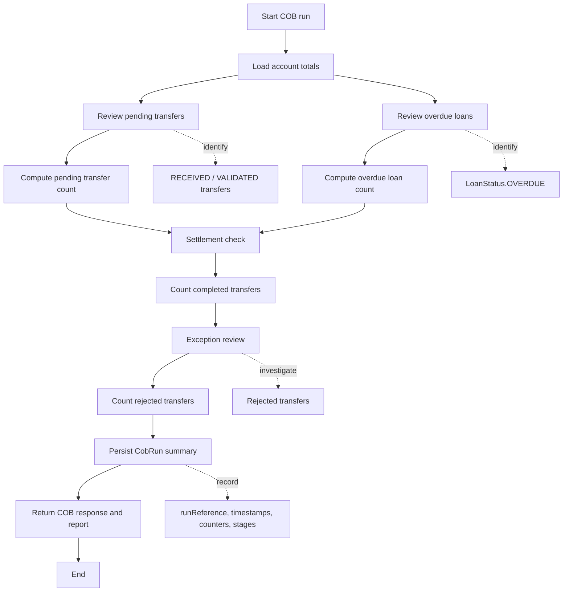
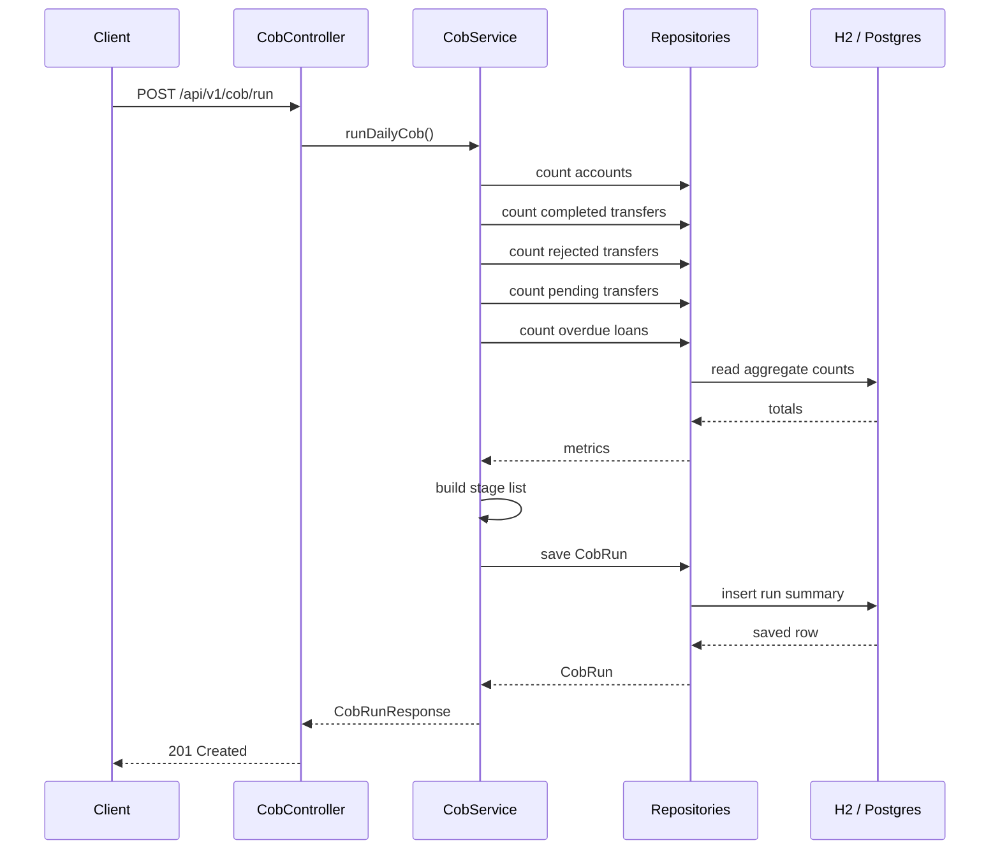

# COB Simulator

This document describes the local end-of-day COB (close of business) simulator built for this project.

The COB simulator is intentionally simple and explicit. It is designed to help reviewers understand the daily-close concept in a small banking model without pretending to be a native Temenos or production banking runtime.

## Purpose

The simulator models a lightweight daily close process for:

- account volume review
- completed vs rejected transfer totals
- pending transfer review
- overdue loan review
- stage-based daily activity summary

It is built for demonstration, validation, and learning rather than full operational parity.

## Scope

The COB flow covers the business activities that are easy to explain in a local review:

- count active accounts
- count completed and rejected transfers
- count pending transfers in review states
- count overdue loans
- record a daily close run with timestamps
- expose a daily report that highlights the detailed close stages

## Design goals

- keep startup fast and local
- require no Docker for the default path
- keep behavior deterministic and easy to review
- make the daily close inspectable through explicit summaries and stage names
- avoid claiming native COB engine compatibility

## Runtime model

The simulator is implemented as a Spring Boot service with a simple persistence model:

- CobService orchestrates the COB close calculation
- CobRun stores the close run metadata
- CobRunResponse exposes the summary payload to API callers
- CobReportResponse exposes the detailed close report

The default local profile uses H2 in-memory storage so reviewers can run the COB flow immediately without infrastructure overhead.

## End-to-end COB flow

The COB process is staged in a compact review-friendly sequence:

1. Pending item review
   - identify transfers still in RECEIVED or VALIDATED states
   - identify overdue loans
2. Settlement check
   - count completed transfers that are ready to be considered in the close summary
3. Exception review
   - count rejected transfers that require investigation
4. Daily close
   - persist the COB run and generate the final summary

This is not a full accounting engine. It is a simulator that shows the idea of daily processing and monitoring in a readable form.

### Process flow diagram



### Sequence view



### Reviewer-friendly ASCII flow

```text
START COB RUN
   |
   v
Load account totals
   |
   +--> Review pending transfers  --> count RECEIVED + VALIDATED
   |
   +--> Review overdue loans      --> count LoanStatus.OVERDUE
   |
   v
Settlement check --> count completed transfers
   |
   v
Exception review --> count rejected transfers
   |
   v
Persist CobRun with timestamps and summary message
   |
   v
Return COB response + daily report
   |
   END
```

## API contract

### Run the COB close

POST /api/v1/cob/run

Example response:

```json
{
  "runReference": "COB-A1B2C3D4",
  "status": "COMPLETED",
  "accountCount": 2,
  "completedTransferCount": 6,
  "rejectedTransferCount": 2,
  "activeLoanCount": 3,
  "pendingTransferCount": 1,
  "overdueLoanCount": 1,
  "processingStages": [
    "PENDING_ITEMS_REVIEW: 3 item(s) require review.",
    "SETTLEMENT_CHECK: 6 completed transfer(s) are ready for settlement.",
    "EXCEPTION_REVIEW: 2 rejected transfer(s) need investigation.",
    "DAILY_CLOSE: close summary recorded."
  ],
  "startedAt": "2026-10-29T07:00:00Z",
  "finishedAt": "2026-10-29T07:00:00Z",
  "summaryMessage": "Daily close processed for local simulator: 6 completed transfers, 2 rejected transfers, 1 pending transfers, 1 overdue loans."
}
```

### Get the latest COB close

GET /api/v1/cob/latest

Returns the most recent COB run summary.

### Get the COB close report

GET /api/v1/cob/report

Returns a detailed daily-close report.

Example response:

```json
{
  "runReference": "COB-A1B2C3D4",
  "summaryMessage": "Daily close processed for local simulator: 6 completed transfers, 2 rejected transfers, 1 pending transfers, 1 overdue loans.",
  "processingStages": [
    "PENDING_ITEMS_REVIEW: 3 item(s) require review.",
    "SETTLEMENT_CHECK: 6 completed transfer(s) are ready for settlement.",
    "EXCEPTION_REVIEW: 2 rejected transfer(s) need investigation.",
    "DAILY_CLOSE: close summary recorded."
  ],
  "pendingTransferCount": 1,
  "rejectedTransferCount": 2,
  "overdueLoanCount": 1,
  "pendingTransferReferences": ["TRF-003"],
  "overdueLoanReferences": ["LN-COB-2"],
  "generatedAt": "2026-10-29T08:00:00Z"
}
```

## Data captured by the COB run

Each COB run stores:

- run reference
- COB status
- account count
- completed transfer count
- rejected transfer count
- active loan count
- pending transfer count
- overdue loan count
- stage summary
- startedAt / finishedAt timestamps
- narrative summary message

## Why this is useful

The simulator helps reviewers understand:

- how close-of-business activity is summarized in a simple system
- how pending financial issues are surfaced in a review queue
- how transfer and loan exceptions can be treated as daily-close concerns
- how a compact API can expose meaningful end-of-day metrics without complex infrastructure

## Notable limitations

This is a demonstration model, not a full banking or Temenos COB system.

It intentionally avoids claims of native runtime compatibility and instead focuses on:

- clear logic
- stable JSON contracts
- local reproducibility
- reviewable finance flows

## Suggested future enhancement

A natural next step is to make the COB process more explicit with:

- review queue items as separate records
- a daily exception list by account or transfer reference
- cumulative daily totals across multiple close runs
- export-friendly report output for reviewer handoff

This would make the simulator more realistic while still staying within its educational and local-first scope.
